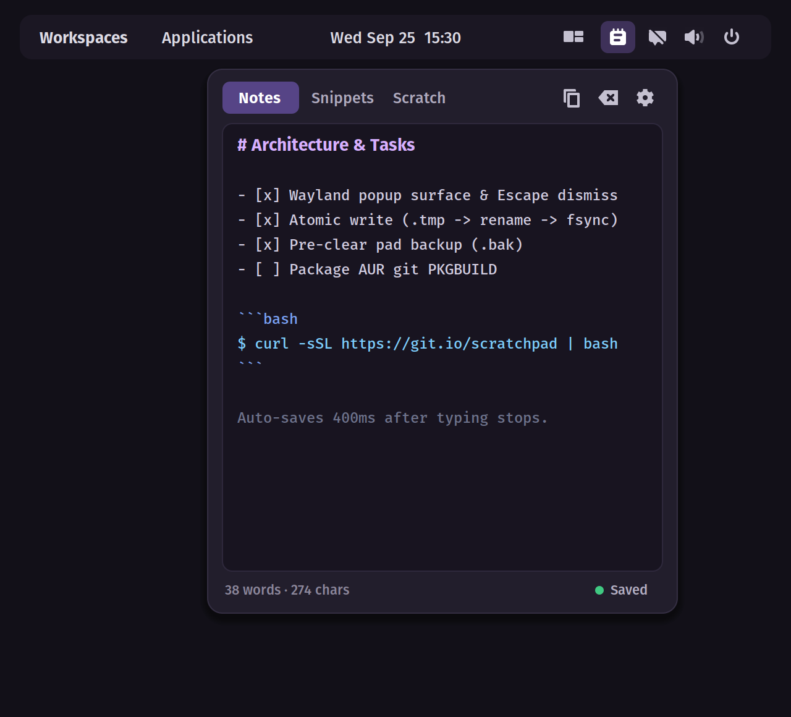

# cosmic-ext-applet-scratchpad

Quick notes and scratchpad applet for the COSMIC desktop environment.

Provides direct access to unlimited plain-Markdown notes from the COSMIC panel.



## Features

- **Dynamic Note Navigation:** Sequential navigation (`<` Previous, `>` Next, `+` New Note) over arbitrary numbers of notes (`pad_N.md`), keeping compatibility with existing 3-pad setups.
- **Notational Velocity Search & Instant Create:** Live search (`Ctrl+F` / `Ctrl+K` or clicking search / note title) filters titles and body text. Pressing `Enter` or clicking create opens a new note with the query as title.
- **Title Derivation:** Derives each note title from its first non-empty Markdown heading or text line without a database.
- **Atomic Storage & Private Permissions:** Notes are stored as plain Markdown files (`pad_N.md`) under `$XDG_DATA_HOME/cosmic-scratchpad/` with private `0700` directory and `0600` file permissions. Writes go to a temporary file, fsync, and atomically rename.
- **Non-Destructive Delete & Undo:** Deleting a note moves it to `trash/` and shows a 5-second inline undo banner. Trashed files older than `trash_retention_days` (default `30`) are purged automatically.
- **Debounced Asynchronous Auto-Save:** Saves in the background 400 ms after typing stops, or immediately when closing the popup or switching notes.
- **External Modification Sync & Conflict Protection:** Checks modification timestamps (`mtime`) on popup open and reloads external disk edits automatically. If both the editor buffer and the file on disk change concurrently, writes the local buffer to `<stem>.conflict-<timestamp>.md` (`0600`) and reloads the disk version without discarding either edit.
- **Clipboard Copy & Paste:** Toolbar Paste button (`Ctrl+V` in editor) and Copy All button (`Ctrl+Shift+C`) with transient status confirmation.
- **Word & Character Counter:** Live counts displayed in the footer.
- **Settings Drawer:** In-app word wrap toggle and font size controls (`10pt` - `24pt`).
- **Native COSMIC Integration:** Uses `libcosmic` widgets, system theming, `cosmic-config`, and AppStream metadata (`com.system76.CosmicApplet`).

## Storage & Synchronization

- **Note Data Directory:** `$XDG_DATA_HOME/cosmic-scratchpad/` (defaults to `~/.local/share/cosmic-scratchpad/`, falling back to `$XDG_RUNTIME_DIR/cosmic-scratchpad/` if `XDG_DATA_HOME` and `HOME` are unset). Directory mode `0700`, file mode `0600`.
- **Trash Directory:** `$XDG_DATA_HOME/cosmic-scratchpad/trash/` (`0700`). Controlled by `trash_retention_days` (default `30` days; `0` disables automatic purging).
- **Configuration:** `$XDG_CONFIG_HOME/cosmic/io.github.hasmolam.cosmic-ext-applet-scratchpad/v1/` (per-key RON files: `wrap_lines`, `font_size`, `active_file`, `trash_retention_days`).

Because notes are plain Markdown files without database wrappers:
- **External Editing:** Files can be edited directly via terminal tools (`cat`, `nvim`, `nano`) or external Markdown tools (Obsidian, VS Code).
- **External Sync:** The directory can be synchronized across machines with Syncthing, Git, Dropbox, or Nextcloud. External edits reload automatically on popup open and while running.
- **Conflict Handling:** Concurrent edits produce `<stem>.conflict-<timestamp>.md` alongside the original note so neither copy is overwritten.

## Keyboard Shortcuts

| Shortcut | Scope | Action |
|---|---|---|
| `Ctrl+F` / `Ctrl+K` | Popup / Editor | Toggle Notational Velocity search bar |
| `Ctrl+N` | Popup / Editor | Create a new note |
| `Ctrl+[` / `Alt+Left` | Popup / Editor | Switch to previous note |
| `Ctrl+]` / `Alt+Right` | Popup / Editor | Switch to next note |
| `Ctrl+Shift+C` | Popup / Editor | Copy active note buffer to system clipboard |
| `Ctrl+V` / Paste button | Editor / Toolbar | Paste clipboard text at cursor |
| `Escape` | Search View | Exit search and return to editor |
| `Escape` | Editor | Close applet popup and flush unsaved edits |
| `Ctrl+Left` / `Ctrl+Right` | Editor | Move cursor by word |
| Standard navigation | Editor | Selection, copy/cut/paste, undo/redo (`Ctrl+A`, `Ctrl+C`, `Ctrl+X`, `Ctrl+V`, `Ctrl+Z`, cursor keys) |

## Installation

Prebuilt `x86_64` and `aarch64` Linux binaries, release tarballs, and `SHA256SUMS` are published on GitHub Releases.

### Method 1: Quick Install Script

Downloads the architecture-matched release binary (`x86_64` or `aarch64`), verifies its SHA-256 digest against `SHA256SUMS`, and installs the binary, desktop entry, AppStream metainfo, and symbolic icon under `~/.local/` (no root required):

```bash
# Download and run interactively (prompts before restarting cosmic-panel):
curl -fsSLO https://raw.githubusercontent.com/Hasmolam/cosmic-ext-applet-scratchpad/main/install.sh
chmod +x install.sh
./install.sh
```

When piped (`curl ... | bash`), `install.sh` does not restart `cosmic-panel` unless `--yes` is passed; either pass `--yes` or run `killall cosmic-panel` afterwards:

```bash
curl -fsSL https://raw.githubusercontent.com/Hasmolam/cosmic-ext-applet-scratchpad/main/install.sh | bash -s -- --yes
```

Flags:
- `-y`, `--yes`: restart `cosmic-panel` without prompting
- `--no-restart`: skip restarting `cosmic-panel`
- `-h`, `--help`: print usage

### Method 2: Manual Install from Release Tarball (No Cargo/Just Required)

Download the tarball and `SHA256SUMS` for `x86_64` or `aarch64`, verify the checksum, and install the files directly:

```bash
# Replace <arch> with x86_64 or aarch64
curl -fsSLO https://github.com/Hasmolam/cosmic-ext-applet-scratchpad/releases/latest/download/cosmic-ext-applet-scratchpad-<arch>-linux.tar.gz
curl -fsSLO https://github.com/Hasmolam/cosmic-ext-applet-scratchpad/releases/latest/download/SHA256SUMS
sha256sum --ignore-missing -c SHA256SUMS

mkdir -p scratchpad-release
tar -xzf cosmic-ext-applet-scratchpad-<arch>-linux.tar.gz -C scratchpad-release
cd scratchpad-release

mkdir -p ~/.local/bin ~/.local/share/applications ~/.local/share/metainfo ~/.local/share/icons/hicolor/scalable/apps
install -Dm0755 cosmic-ext-applet-scratchpad ~/.local/bin/cosmic-ext-applet-scratchpad
install -Dm0644 data/io.github.hasmolam.cosmic-ext-applet-scratchpad.desktop ~/.local/share/applications/io.github.hasmolam.cosmic-ext-applet-scratchpad.desktop
install -Dm0644 data/io.github.hasmolam.cosmic-ext-applet-scratchpad.metainfo.xml ~/.local/share/metainfo/io.github.hasmolam.cosmic-ext-applet-scratchpad.metainfo.xml
install -Dm0644 data/icons/scalable/apps/io.github.hasmolam.cosmic-ext-applet-scratchpad-symbolic.svg ~/.local/share/icons/hicolor/scalable/apps/io.github.hasmolam.cosmic-ext-applet-scratchpad-symbolic.svg

update-desktop-database ~/.local/share/applications 2>/dev/null || true
gtk-update-icon-cache -f -t ~/.local/share/icons/hicolor 2>/dev/null || true
killall cosmic-panel
```

### Method 3: Arch Linux (PKGBUILD)

```bash
git clone https://github.com/Hasmolam/cosmic-ext-applet-scratchpad.git
cd cosmic-ext-applet-scratchpad/packaging/arch
makepkg -si
```

### Method 4: Build from Source

#### Build Dependencies (Ubuntu/Pop!_OS)

```bash
sudo apt-get update
sudo apt-get install -y cmake libexpat1-dev libfontconfig-dev libfreetype-dev libxkbcommon-dev libwayland-dev pkg-config just
```

#### Compiling and Installing

```bash
git clone https://github.com/Hasmolam/cosmic-ext-applet-scratchpad.git
cd cosmic-ext-applet-scratchpad

# System-wide installation (installs to /usr, requires sudo):
sudo just install

# Or user-local installation (installs to ~/.local, no root required):
just install-user
```

For offline/packaged builds using vendored dependencies:

```bash
just vendor
just build-vendored
```

### Adding to the Panel

In COSMIC Desktop settings:
`Settings -> Desktop -> Panel -> (Select your Top or Bottom Panel) -> Applets -> Add Applet -> "Scratchpad"`

## Troubleshooting

### Applet does not appear in "Add Applet" list
1. Ensure `~/.local/bin` is present in your environment `PATH`:
   ```bash
   echo $PATH | grep -q "$HOME/.local/bin" && echo "OK" || echo "Missing ~/.local/bin"
   ```
   If missing, add it to your shell configuration (`~/.bashrc`, `~/.zshrc`, or `~/.profile`):
   ```bash
   export PATH="$HOME/.local/bin:$PATH"
   ```
2. Re-register the desktop application cache:
   ```bash
   update-desktop-database ~/.local/share/applications
   ```
3. Restart the COSMIC panel process:
   ```bash
   killall cosmic-panel
   ```

## Uninstallation

If installed via the quick install script:

```bash
curl -fsSL https://raw.githubusercontent.com/Hasmolam/cosmic-ext-applet-scratchpad/main/uninstall.sh | bash -s -- --yes
```

Or from a local repository clone or unpacked release tarball:

```bash
./uninstall.sh
# or via just:
sudo just uninstall
just uninstall-user
```

User notes in `~/.local/share/cosmic-scratchpad/` are preserved.

## Development

```bash
# Check formatting, lints, and unit tests
just check

# Run directly
just run
```

## License

GPL-3.0-only
